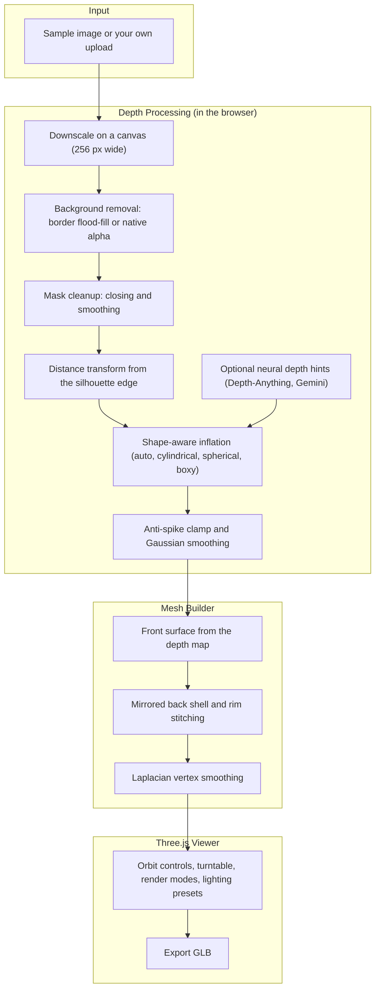

<div align="center">

# 🧊 2D to 3D
### Turn a Flat 2D Image into an Interactive 3D Model, Right in Your Browser

[](https://2d-to-3d-phi.vercel.app)
[](https://react.dev/)
[](https://threejs.org/)
[](https://www.typescriptlang.org/)
[](https://vite.dev/)
[](https://tailwindcss.com/)

*A computer vision web app that removes the background from an image, estimates depth from its shape, and builds a smooth, solid 3D mesh you can orbit, tweak and export.*

[Live Demo](https://2d-to-3d-phi.vercel.app) • [Features](#-features) • [How It Works](#-how-it-works) • [Settings](#-settings) • [Quick Start](#-quick-start) • [Deploy](#-deploy-on-vercel) • [Future Scope](#-future-scope)

</div>

---

## 🌍 Overview

Most 3D reconstruction tools need special hardware, multiple photos or a heavy installation. **2D to 3D** explores how far a single ordinary image can go.

The app processes your image entirely in the browser:
1. **Image processing:** Separates the subject from the background and cleans up its silhouette.
2. **Depth estimation:** Builds a depth map from the shape of the subject, with optional AI depth hints blended in.
3. **3D reconstruction:** Turns the depth map into a watertight mesh with a front surface and a mirrored back shell.
4. **Interactive viewing:** Lets you orbit, relight, restyle and export the result with Three.js.

---

## ✨ Features

- 🖼️ **Image input:** Start from one of six built-in sample images (sneaker, helmet, chair, vase, game controller, headphones) or upload your own.
- ✂️ **Background removal:** Flood-fills inward from the image borders, or uses the image's own transparency when it has one.
- 📐 **Depth from silhouette:** A distance transform plus shape-aware inflation gives rounded, believable volume.
- 🧱 **Shape profiles:** Choose `auto`, `cylindrical`, `spherical` or `boxy` so vases, balls and hard-surface objects keep their proportions.
- 🧠 **Optional AI depth hints:** Can blend in a Depth-Anything map (Transformers.js) and a Gemini depth grid when they are available.
- 🧊 **Watertight mesh:** Front surface, mirrored back shell and stitched rim, followed by Laplacian vertex smoothing.
- 🎛️ **Tunable output:** Adjust depth, resolution, smoothing, background cutoff, taper and more.
- 🎥 **Interactive viewer:** Orbit controls, turntable, render modes, lighting presets, wireframe overlay and material controls.
- 📦 **Export:** Download the finished model as a glTF / GLB file.

---

## 🧱 How It Works



| Step | Stage | What happens |
| :---: | :--- | :--- |
| **1** | **Image input** | Pick a sample image or upload your own. |
| **2** | **Background removal** | The subject is separated from the background and its silhouette mask is cleaned up. |
| **3** | **Depth estimation** | Distance from the silhouette edge is inflated into volume using the chosen shape profile, then blended with optional AI depth. |
| **4** | **Smoothing** | Spikes are clamped and the depth map is smoothed. Depth, normal and mask maps are generated. |
| **5** | **3D reconstruction** | A front surface and a mirrored back shell are meshed and stitched along the silhouette. |
| **6** | **Visualization** | Orbit around the model, change lighting and render mode, and tune the settings. |
| **7** | **Export** | Save the generated 3D model. |

---

## 🔧 Settings

Default values used by the converter:

| Setting | Default | What it controls |
| :--- | :---: | :--- |
| Depth intensity | `1.65` | How far the surface pushes out in 3D. |
| Resolution | `128` | Mesh grid detail (the builder clamps it between 48 and 180). |
| Smooth passes | `3` | How much the depth map is smoothed. |
| Background cutoff | `0.15` | How aggressively the background is removed. |
| Extrusion taper | `0.95` | How strongly the back shell mirrors the front. |
| Shape profile | `auto` | `auto`, `cylindrical`, `spherical` or `boxy` volume prior. |
| Watertight solid | on | Builds a closed solid instead of a relief. |
| Remove background | on | Isolates the subject. |
| Anti-spike filter | on | Clamps sharp depth spikes. |
| Invert depth | off | Flips the depth direction. |
| Render mode | `textured` | How the mesh is drawn. |
| Lighting preset | `studio` | Light setup in the viewer. |
| Turntable speed | `0.6` | Auto-rotation speed. |
| Roughness / Metalness | `0.28` / `0.22` | Material look. |

---

## 📂 Repository Structure

```text
2d-to-3d/
├── src/                          # App source files
├── ai_2d_to_3d_converter.tsx     # Converter: image processing, mesh builder and 3D viewer
├── index.html                    # Vite entry HTML
├── package.json                  # Dependencies and scripts
├── package-lock.json             # Locked dependency versions
├── vite.config.ts                # Vite configuration
├── tailwind.config.js            # Tailwind CSS configuration
├── postcss.config.js             # PostCSS configuration
├── tsconfig.json                 # TypeScript configuration
├── tsconfig.node.json            # TypeScript configuration for Vite config files
├── .gitignore
└── README.md                     # Project documentation
```

---

## 🧰 Tech Stack

| Technology | Purpose |
| :--- | :--- |
| **React 19** | User interface |
| **TypeScript** | Typed application code |
| **Three.js** | 3D rendering, OrbitControls, GLTF / OBJ loaders and GLTF exporter |
| **Vite** | Dev server and production build |
| **Tailwind CSS 3** | Styling |
| **lucide-react** | Icons |

---

## 🚀 Quick Start

### Prerequisites
- **Node.js** (a recent LTS version)
- **npm**
- **Git**

### 1. Clone the Repository
```bash
git clone https://github.com/KiranJITdesign/2d-to-3d.git
cd 2d-to-3d
```

### 2. Install Dependencies
```bash
npm install
```

### 3. Start the Dev Server
```bash
npm run dev
```
Open the address Vite prints (usually `http://localhost:5173`). The server also listens on your local network, so you can open it from a phone on the same Wi-Fi.

### Other Scripts
| Command | What it does |
| :--- | :--- |
| `npm run dev` | Starts the Vite dev server. |
| `npm run build` | Creates a production build. |
| `npm run preview` | Serves the production build locally. |

---

## 🎮 Usage

1. Open the app.
2. Choose a sample image or upload your own.
3. Let the converter build the depth map and mesh.
4. Orbit around the model and adjust the settings until it looks right.
5. Switch render modes and lighting presets to inspect the surface.
6. Export the finished model.

---

## 🌐 Deploy on Vercel

1. Push the repo to GitHub.
2. On [vercel.com](https://vercel.com) choose **Add New > Project** and import the repo.
3. Vercel detects Vite automatically. Click **Deploy**.

The current deployment lives at https://2d-to-3d-phi.vercel.app.

---

## 📝 Notes

- Everything runs in your browser. Images are not uploaded to a server for the core conversion.
- Remote sample images that block cross-origin access are retried through a public image proxy, and fall back to a placeholder if that fails.
- A single image has no information about the hidden side of an object, so the back is a mirrored estimate. Results are strongest for compact, solid subjects on a plain background.

---

## 🔮 Future Scope

- ⚡ Real-time 2D-to-3D conversion
- 🎯 Improved depth estimation accuracy
- 🧱 Export to `.obj` and `.stl`
- 🚀 GPU-accelerated processing
- 🥽 AR and VR integration

---

## 🤝 Contributing

Contributions, suggestions and improvements are welcome.

1. Fork the repository.
2. Create a new branch.
3. Make your changes.
4. Commit and push.
5. Open a Pull Request.

---

## 📄 License

Released under the ISC license, as declared in `package.json`.
